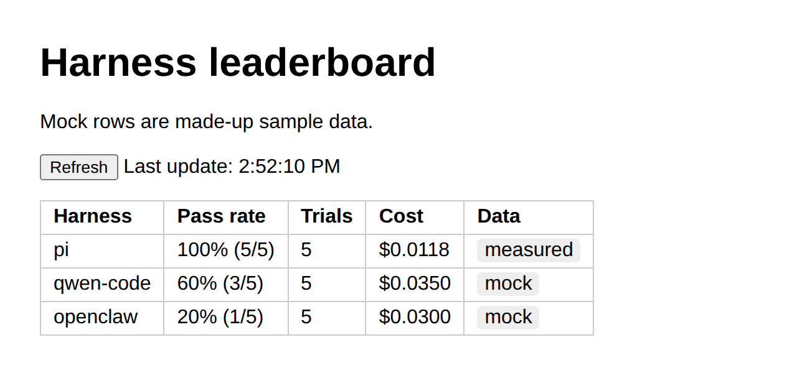
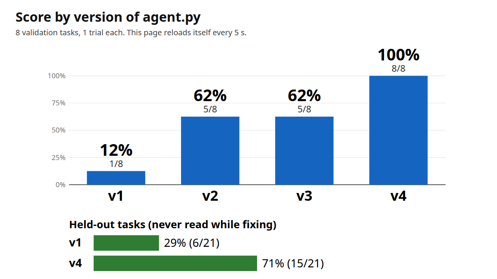

# Agent Harnesses: two live workshops (AI Dev NYC 2026)

A harness is the code around the model: the loop, the tools and the prompts. This repository holds the hands-on material of two live workshops at AI Dev NYC. In Part 1 (Mon 30 Nov) you measure how much the harness changes a benchmark score. In Part 2 (Tue 1 Dec) you fix a flawed harness and measure each fix. Each part works without the other. The measuring is pre-built. Everything else is yours to decide, and your own coding agent does the typing.

## Before the session

You need:

- A laptop with git and [uv](https://docs.astral.sh/uv/getting-started/installation/).
- A coding agent that you already use, logged in (for example Claude Code, Codex or Cursor).
- A [Hugging Face](https://huggingface.co/join) account with credits. Both parts together cost under 2 dollars.
- A Hugging Face token of type **Write** ([create one](https://huggingface.co/settings/tokens)).

The setup takes about 5 minutes. Do it before the session.

```bash
git clone https://github.com/JoelNiklaus/aidev-harness-workshop
cd aidev-harness-workshop
uv tool install ./hands-on/part1-swarm/runner --with-executables-from "aidev-evolve @ ./hands-on/part2-evolve" --with-executables-from huggingface-hub
hf auth login
aidev-lb check
```

| Command | Expected output |
|---|---|
| `uv tool install ...` | after a few seconds: `Installed 1 executable: aidev-lb`, and the same line for `aidev-evolve` and `hf` |
| `hf auth login` | asks for your token, then `Login successful` |
| `aidev-lb check` | after 15 to 35 seconds: `ready: <you> can call the workshop model, run HF Jobs and use HF Sandboxes.` |

`check` makes one model call, runs one small cloud job and one sandbox command. It costs under 1 cent.

## Part 1 (live workshop, Mon 30 Nov): build a harness leaderboard

A benchmark score belongs to the model and its harness together. You build a web page that compares coding-agent harnesses. All of them use the same model (GLM-5.3-Flash) on the same tasks (Terminal-Bench 2.1). One command measures a harness in the cloud. The page is yours: you decide what it shows, and your coding agent writes it.



```bash
cd hands-on/part1-leaderboard
```

Start your coding agent in this folder and tell it what you want, in your own words. It reads `AGENTS.md` there, which holds the facts below. There are four challenges.

### Challenge 1: build your leaderboard page from the sample data

**Goal.** A page `index.html` that compares the harnesses in the sample data.

**Fixed.** `sample-results.json` holds 15 made-up records: 3 harnesses on 5 tasks. One record is one harness on one task:

```json
{"harness": "pi", "task": "kv-store-grpc", "passed": true, "cost_usd": 0.002, "wall_s": 60.0, "source": "sample"}
```

`cost_usd` is the model cost and `wall_s` the seconds of that run. One rule: the page marks made-up results as mock. As soon as a harness has measured results, the page shows only those for that harness.

**Your decisions.** What the page shows and how. Some options: a ranking, columns such as pass rate, cost per solved task or time, a grid of tasks by harnesses, a chart, your own style. Plain HTML is the fastest to build; anything your agent builds fast is fine.

**Done when** the page opens with a double-click and shows the three mock harnesses, marked as mock.

### Challenge 2: put it online

**Goal.** Your page is online and reads your own results.

**Fixed.** A static Hugging Face Space hosts the page for free at `https://<you>-<space name>.static.hf.space`. The measuring command of challenge 3 writes your results to `https://huggingface.co/buckets/<you>/harness-results/resolve/results.json`. This file does not exist before your first run, so the page keeps the mock data until then. The page reads the file at most once a minute, or when you click a button: the whole room shares one network address and its read limit.

**Your decisions.** The name of the Space, and what the page looks like while it has no measured results.

**Done when** the Space address shows your page with the three mock harnesses.

### Challenge 3: measure

**Goal.** The first measured result on your page.

**Fixed.** This command runs the Pi harness on 5 tasks in one cloud job. It takes 1 to 2 minutes and costs about 1 cent. It prints the address of the job page and one line per finished task. It writes the results to `results.json` in this folder and to your bucket.

```bash
aidev-lb run --harness pi
```

**Your decisions.** What to do while it runs: watch the job page, or go on with your page.

**Done when** Pi on your page shows your measured numbers and is no longer marked as mock.

### Challenge 4: choose what to compare

**Goal.** An answer to this question: which harness would you pick for this model, and how sure are you?

**Fixed.** 10 harnesses are ready. The speed is the install time in a fresh sandbox.

| Speed | Harnesses |
|---|---|
| fast (under a minute) | `pi`, `qwen-code`, `kimi-code`, `mini-swe-agent` |
| medium | `openclaw`, `deepseek-harness`, `claude-code` |
| slow (2 to 3 minutes or more) | `codex`, `opencode`, `hermes` |

One job per harness, all at the same time. Most results arrive within 3 minutes; a slow trial can take 9. A harness that is not in the sample data appears on your page as a new entry.

```bash
aidev-lb run --harness qwen-code --harness openclaw
```

**Your decisions.** Which harnesses: fast ones that differ are a good start, for example `qwen-code` and `openclaw`. How many tasks: 5, or 10 with `--tasks 10`. Whether to run a harness a second time to see the noise: `--out results-2.json --no-bucket` keeps the second run in its own file.

**Done when** your page shows at least three measured harnesses and you can answer the question.

Ideas for the waiting time, all for your coding agent: cost per solved task, a grid of tasks by harnesses, the spread between two runs of the same harness, a chart of pass rate against cost.

### If you are stuck

Sample requests for your coding agent are in `hints/sample-prompts.md`, and a finished page is in `hints/sample-solution.html` (both in `hands-on/part1-leaderboard`).

### After the session

- More tasks: `aidev-lb run --harness pi --tasks 10` runs 10 tasks in place of 5.
- More trials: one trial per task is noisy. Run a harness several times with `--out` and `--no-bucket`, and show the spread.
- Another model: the model is set in the source of the runner, `hands-on/part1-swarm/runner`. Does the ranking of the harnesses stay the same?
- Audit: did a harness look up the answer? See [take-home-audit.md](hands-on/part1-leaderboard/docs/take-home-audit.md).
- How it works: [architecture.md](hands-on/part1-leaderboard/docs/architecture.md) and [results-format.md](hands-on/part1-leaderboard/docs/results-format.md).

## Part 2 (live workshop, Tue 1 Dec): fix a harness and watch its score go up

You get a small harness with flaws and one command that scores it. You find out why it fails, change it and measure the change. The scoring is pre-built. The investigation and the changes are yours: you decide where to look and what to try. Your coding agent is your teacher here: it shows you where to look and makes the changes you decide. It will not hand you the answer.



```bash
cd hands-on/part2-harness
```

Start your coding agent in this folder and ask it questions, in your own words. It reads `AGENTS.md` there, which makes it a teacher and holds the facts below. There are three challenges.

### Challenge 1: run the baseline

**Goal.** The score of the harness as it is: version 1, the number to beat.

**Fixed.** `agent.py` is a small harness: a loop around a fixed model, with about 10 settings at the top. This command scores the current `agent.py` on 8 terminal tasks in one cloud job. It takes about 90 seconds and costs about 1 cent. It prints the address of the job page and one line per task. It saves the file as the next version, writes the trajectory of every task to `traces/vN/` and adds a bar to `chart.html`.

```bash
aidev-evolve eval
```

**Your decisions.** What to do while it runs: watch the job page, or read `agent.py` and guess what holds it back.

**Done when** `chart.html` shows the bar of version 1. Open it with a double-click and leave it open: it reloads itself.

### Challenge 2: find the flaws, fix them, measure each fix

**Goal.** Versions of `agent.py` that solve more tasks than version 1, and a chart that shows it.

**Fixed.** Three flaws are planted in the harness on purpose. The model, the tasks and the time per task are fixed (see `CONTRACT.md`). The evidence is in the trajectories: read `traces/vN/INDEX.md` first. After every change you run `aidev-evolve eval` again (1 to 3 minutes, 1 to 4 cents), and the chart gets a new bar.

**Your decisions.** How to investigate: read `INDEX.md` yourself, ask your agent which tasks ended with time left, ask it to show you a step of a failed task, compare a passed and a failed trajectory, or read the harness. What the diagnosis is and what to change: say both in your own words, and your agent checks them against the trajectories and makes the edit. How much to change per version.

**Advice.** Change one thing per version: then the chart tells you what each change was worth. Your agent does not name a flaw and does not fix one by itself. Ask it for a hint when you are stuck: each time you ask, the hint gets clearer. One evaluation is 8 tasks with one try each, so the same version can score one task more or less in a second run.

**Done when** at least one bar is higher than version 1. With all three flaws fixed, the harness solves 7 or 8 of 8.

### Challenge 3: check on held-out tasks

**Goal.** A score for your best version on tasks that nobody looked at.

**Fixed.** You fixed the harness while you read the trajectories of these 8 tasks, so their score flatters it a little. This command scores your latest version and version 1 on 20 other tasks (3 to 4 minutes, 9 to 13 cents). Both scores appear below the chart.

```bash
aidev-evolve eval --heldout
```

**Your decisions.** When to run it: after your last fix, or earlier to see how much of a gain carries over.

**Done when** the chart shows both held-out scores and you can say how much of your gain holds on the new tasks.

### If you are stuck

Ask your coding agent for a hint, and ask again for a clearer one. Sample questions are in `hints/sample-prompt.md`, and `hints/hint-1.md` to `hint-3.md` reveal one flaw each: first the symptom, then the setting (all in `hands-on/part2-harness`).

### After the session

- Automate it: you ran this loop by hand. In practice a proposer model writes the changes, and a search keeps the versions that score higher. Start with Meta-Harness, where you can add your own benchmark: [github.com/stanford-iris-lab/meta-harness](https://github.com/stanford-iris-lab/meta-harness). My fork with more experiments: [github.com/JoelNiklaus/harness-optimization](https://github.com/JoelNiklaus/harness-optimization).
- Go on with this harness: it has more to gain than the three planted flaws. Every version stays in `versions/vN/agent.py`, so you can always go back.
- Your own agent: [take-home.md](hands-on/part2-harness/docs/take-home.md) shows how to build the same loop around it.
- How it works: [how-eval-works.md](hands-on/part2-harness/docs/how-eval-works.md).

## If something fails

| You see | Do this |
|---|---|
| `aidev-lb`, `aidev-evolve` or `hf`: `command not found` | Run `uv tool update-shell`, then open a new terminal. |
| `No Hugging Face token`, `401`, `403`, or `Could not write to the bucket` | Create a new token of type **Write** at https://huggingface.co/settings/tokens, then run `hf auth login` again. |
| `no credits` or `402` | Add credits at https://huggingface.co/settings/billing, then run the command again. |
| A trial prints `no result`, or the Job failed | Run the same command again. In Part 1 new results replace old ones. In Part 2 nothing was recorded. |
| Part 1: the page shows only mock data after a run | Reload the page. Open your bucket address from challenge 2 in the browser: it must show JSON. Then ask your coding agent to compare that address with the one in `index.html`. |
| Part 1: the online page does not show your last change | Ask your coding agent to upload the page to the Space again, then reload. |
| Part 2: `agent.py is unchanged since vN` | Nothing changed yet. Tell your coding agent the change you decided, then run the command again. |
| Part 2: `agent.py does not compile` | Ask your coding agent to fix the error, or go back with `cp versions/vN/agent.py agent.py`. |

Every command prints the page of its cloud job. All your jobs are listed at https://huggingface.co/settings/jobs.

## License

Apache-2.0, see [LICENSE](LICENSE).
